# Lab 6: Set Up Nexus Repository and Configure User Access

**Estimated duration:** 3 hours  
**Execution environment:** Run Nexus and all Docker/curl commands directly on the Ubuntu server  
**Previous work:** Reuse the IntelliJ IDEA environment, `java-app` Gradle project and `java-maven-app` Maven project from Lab 5  
**Submission repository:** `DevOps`  
**Submission directory:** `Labs/Lab06`  
**Screenshot directory:** `Labs/Lab06/screenshots`

This lab continues from Lab 5, but Nexus must run directly on the **Ubuntu server**, not inside the IntelliJ container. Use the Ubuntu server terminal for the Nexus `docker run`, `docker ps`, `docker exec`, logs, and user-verification `curl` commands. Reuse the IntelliJ IDEA environment, the `java-app` Gradle project for Task 3 and the `java-maven-app` Maven project for Task 4.

```text
DevOps/
└── Labs/
    └── Lab06/
        ├── README.md
        ├── Lab6_Solution.pdf
        ├── images/                     # Instructor reference images
        └── screenshots/
```

The instructor supplies this README. Create your own screenshots directory and solution PDF.

## Lab Objective

By the end of this lab, you will be able to:

- Reuse the IntelliJ IDEA environment and Gradle project prepared in Lab 5.
- Run Nexus Repository in Docker with persistent storage.
- Complete the initial Nexus administrator setup without exposing credentials.
- Disable anonymous access.
- Create a Nexus role for the Maven snapshots repository.
- Create an active local user and assign the role.
- Verify the user's credentials through the Nexus Status API.
- Configure a Gradle project for Maven publication.
- Build a Java JAR and publish it to the Nexus `maven-snapshots` repository.
- Verify the published Gradle JAR and Maven metadata in Nexus.
- Configure Maven distribution management and authenticated deployment.
- Publish a Maven snapshot JAR and verify it in Nexus.
- Query Nexus repositories and components through authenticated REST API requests.
- Inspect Nexus blob storage and create a file blob store.
- Create a Docker hosted repository backed by the new blob store.
- Create, schedule and manually run a cleanup policy for Maven snapshots.
- Compact the default blob store and verify that disk space is reclaimed.

## Prerequisites

- Complete Lab 5 and keep the existing `Intellij-Idea-docker` environment.
- Keep or reopen the Lab 5 Gradle project at `/config/IdeaProjects/java-app`.
- Keep or reopen the Lab 5 Maven project at `/config/IdeaProjects/java-maven-app`.
- Docker must be installed and running directly on the Ubuntu server.
- Run the Task 1, Task 2, Task 5 and Task 6 Nexus container and REST API commands from the Ubuntu server terminal, not from an IntelliJ terminal or container shell.
- Ports `8006` and `8007` must be available on the Ubuntu Docker host.
- Know the IP address of the Ubuntu computer or server on which Docker is running.
- Use a strong password for the Nexus `admin` account and a different strong password for the `nexus` user.

## Task List

- [Getting Started](#getting-started)
- [Task 1: Run Nexus Repository and Complete the Initial Setup](#task-1-run-nexus-repository-and-complete-the-initial-setup)
- [Task 2: Create a Role and User and Verify Access](#task-2-create-a-role-and-user-and-verify-access)
- [Task 3: Build and Publish the Gradle Application to Nexus](#task-3-build-and-publish-the-gradle-application-to-nexus)
- [Task 4: Publish the Maven Application to Nexus](#task-4-publish-the-maven-application-to-nexus)
- [Task 5: Inspect Nexus Repositories and Components Using the REST API](#task-5-inspect-nexus-repositories-and-components-using-the-rest-api)
- [Task 6: Create a Nexus Blob Store and Docker Hosted Repository](#task-6-create-a-nexus-blob-store-and-docker-hosted-repository)
- [Task 7: Create and Run a Maven Snapshot Cleanup Policy](#task-7-create-and-run-a-maven-snapshot-cleanup-policy)
- [Summary](#summary)
- [Final Submission Checklist](#final-submission-checklist)
- [Submission](#submission)
- [Official References](#official-references)

---

## Mandatory Screenshot and Autograding Rules

Read these rules before starting. Each required screenshot is evaluated separately.

1. Use an Ubuntu account whose terminal prompt shows your registered GitHub username before `@` and `ubuntu` as the hostname:

   ```text
   YourGitHubUsername@ubuntu:~$
   ```

   The comparison is case-insensitive, but the spelling must match the `user_name` registered in the Student Marks Portal.

2. Every terminal screenshot must clearly show:
   - `YourGitHubUsername@ubuntu` in the prompt;
   - the required command; and
   - its relevant result or output.

3. For Nexus browser pages and IntelliJ dialog/editor evidence, keep a terminal showing `YourGitHubUsername@ubuntu` visible in the same screenshot. Keep the required fields, code and results readable.

4. Save every screenshot inside:

   ```text
   Labs/Lab06/screenshots/
   ```

5. Use the exact filename and capitalization given in this document. Do not add numbers or alternative spellings.

6. Screenshots may use any image dimensions, but their text and evidence must be clear and readable.

7. A screenshot containing only a command, only filled but unsaved form fields, or unrelated output is not proof of completion.

8. Do not expose either Nexus password, the generated `admin.password` value, access tokens, private keys, or other secrets in a screenshot or solution file.

9. Exact and visually near-duplicate screenshots are compared across students for the same task. If two students submit the same or slightly modified screenshot, both may receive zero for that task.

10. Commit and push the complete `Labs/Lab06` directory to your `DevOps` repository before the deadline. Files that remain only on your computer cannot be graded.

The images embedded below are **instructor reference images only**. They illustrate the expected Nexus pages, but they are not student evidence. Do not download, copy, edit, or submit these images as your screenshots; capture your own work on your own Nexus server.

### Required Screenshot Filenames

Lab 6 currently requires these 28 screenshots:

```text
nexus_container_running.png
nexus_user_access.png
gradle_nexus_configuration.png
gradle_nexus_build.png
gradle_nexus_publish.png
nexus_gradle_artifact.png
maven_nexus_project.png
maven_distribution_management.png
maven_package_nexus.png
maven_deploy_nexus.png
nexus_maven_artifact.png
nexus_repositories_user.png
nexus_repositories_admin.png
nexus_components_list.png
nexus_component_details.png
nexus_default_blob_content.png
nexus_mystore_created.png
nexus_blob_directories.png
nexus_docker_hosted_repository.png
nexus_cleanup_policy_created.png
nexus_cleanup_policy_attached.png
nexus_cleanup_task_waiting.png
nexus_cleanup_task_completed.png
nexus_maven_snapshots_empty.png
nexus_blob_store_before_compaction.png
nexus_compact_task_configured.png
nexus_compact_task_completed.png
nexus_blob_store_after_compaction.png
```

Each required screenshot has equal weight.

---

## Getting Started

1. Create the Lab 6 evidence directory in your existing `DevOps` repository:

   ```bash
   cd ~/DevOps
   mkdir -p Labs/Lab06/screenshots
   ```

2. Connect to the Ubuntu server using your registered GitHub username, unless you are already signed in locally:

   ```bash
   ssh <github-username>@<ubuntu-server-ip>
   ```

3. Verify Docker directly on the Ubuntu server:

   ```bash
   docker --version
   docker ps
   ```

4. Keep the Lab 5 IntelliJ IDEA environment and these projects for Tasks 3 and 4:

   ```text
   /config/IdeaProjects/java-app
   /config/IdeaProjects/java-maven-app
   ```

   If either project does not exist, its task explains how to clone it. Do **not** use the IntelliJ container shell to run Nexus. Run every command in Tasks 1, 2, 5 and 6 from the Ubuntu server terminal.

---

## Task 1: Run Nexus Repository and Complete the Initial Setup

1. **Start the Nexus container**

   In the Ubuntu server terminal, run:

   ```bash
   docker run -d \
     --name nexus \
     --restart unless-stopped \
     -p 8006:8081 \
     -p 8007:8007 \
     -v nexus-data:/nexus-data \
     sonatype/nexus3:latest
   ```

   This command creates a container named `nexus`. Host port `8006` opens the Nexus web interface, host port `8007` is reserved for a later repository task, and the named volume `nexus-data` keeps Nexus data when the container restarts.

   If you previously created the container and it is stopped, do not run the creation command again. Start the existing container with:

   ```bash
   docker start nexus
   ```

2. **Verify that Nexus is running**

   Run:

   ```bash
   docker ps | grep nexus
   ```

   Wait until the output shows the `nexus` container. The first startup can take several minutes. If the browser is not ready yet, inspect startup progress with:

   ```bash
   docker logs -f nexus
   ```

   Press **Ctrl+C** after Nexus finishes starting. This stops only the log display; it does not stop the container.

   - Screenshot as `nexus_container_running.png`, showing `docker ps | grep nexus`, the running `nexus` container, and the published ports.

3. **Open the Nexus login page**

   On a computer that can reach the Ubuntu Docker host, open:

   ```text
   http://<ubuntu-server-ip>:8006
   ```

   Replace `<ubuntu-server-ip>` with the real IP address. The first login username is:

   ```text
   admin
   ```


   **Instructor reference image:**

   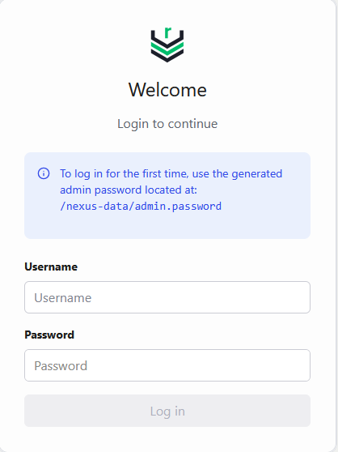

4. **Retrieve the one-time administrator password**

   Return to the Ubuntu server terminal and run:

   ```bash
   docker exec nexus cat /nexus-data/admin.password
   ```

   Copy the generated value privately and use it once to sign in as `admin`. **Do not take a screenshot of this command or its output.** Clear the visible terminal immediately afterward:

   ```bash
   clear
   ```

5. **Complete the setup wizard**

   Complete the pages shown by Nexus in this order:

   1. Select **Next** on **Let's Get You Set Up**.

      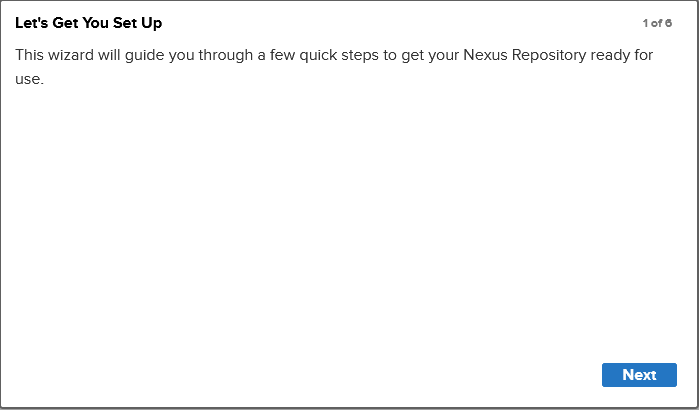

   2. Enter and confirm a new strong password for the `admin` user, then select **Next**.

      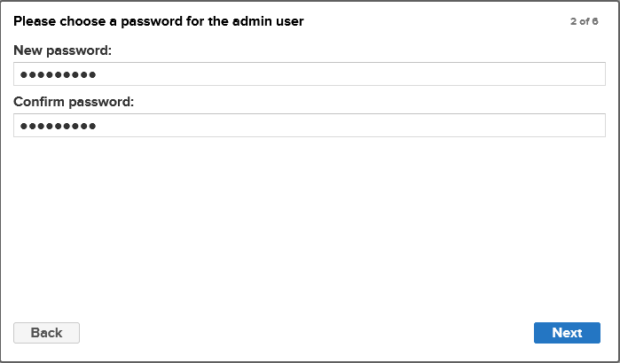

   3. Continue with **Nexus Repository Community Edition**.

      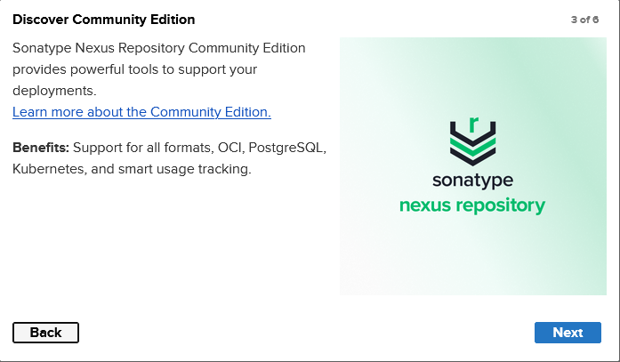

   4. Read the End User License Agreement, scroll as required, and select **Agree**.

      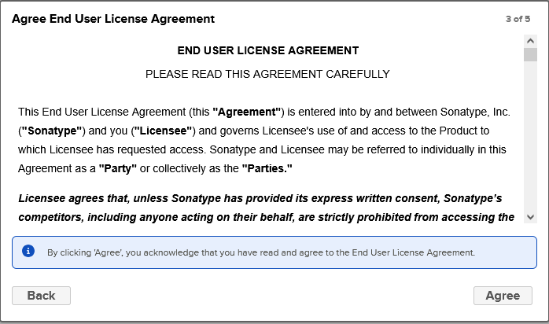

   5. On **Configure Anonymous Access**, select **Disable anonymous access**, then select **Next**.

      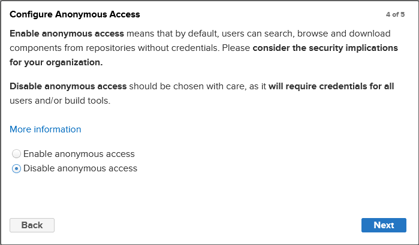

   6. On **Setup Complete**, select **Finish**.

      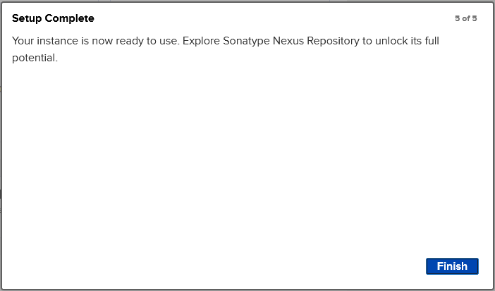

**Screenshot Required:**

- `nexus_container_running.png`

**Summary:** Nexus is running in Docker with persistent data, the initial administrator password has been replaced, and anonymous access is disabled.

---

## Task 2: Create a Role and User and Verify Access

1. **Create the `nx-java` role**

   Sign in as `admin`, open **Settings**, and go to **Security → Roles**. Select **Create Role** and enter:

   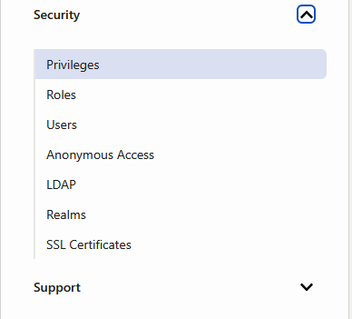

   | Field | Value |
   | --- | --- |
   | Type | `Nexus role` |
   | Role ID | `nx-java` |
   | Role Name | `nx-java` |
   | Role Description | `Maven snapshots role` |

   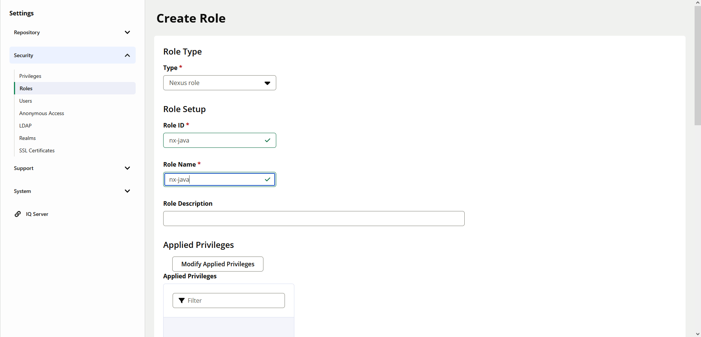

   Under **Applied Privileges**, select **Modify Applied Privileges**. Search for `maven2-maven-snapshots`, select this privilege, and confirm the selection:

   ```text
   nx-repository-view-maven2-maven-snapshots-*
   ```

   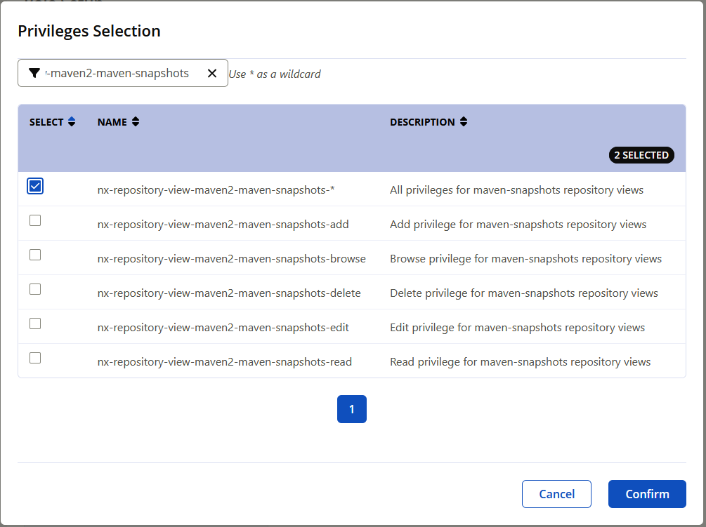

   After confirming the selection, verify that the privilege appears under **Applied Privileges**:

   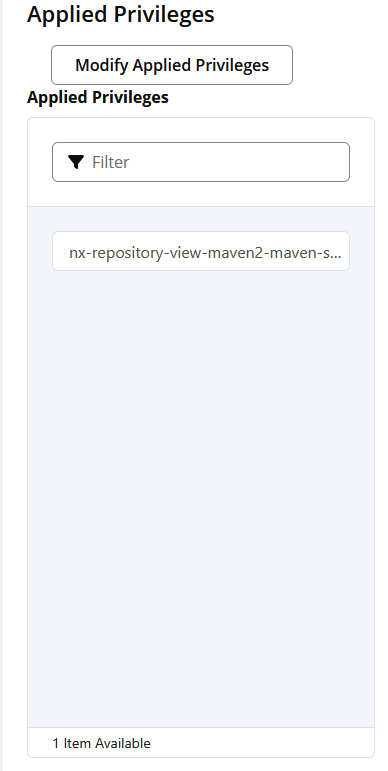

   Save the role. Reopen the saved role if necessary to show its details.

2. **Create the local `nexus` user**

   Go to **Settings → Security → Users**, select **Create local user**, and enter:

   | Field | Value |
   | --- | --- |
   | ID | `nexus` |
   | First name | `nexus` |
   | Last name | `dev` |
   | Email | `nexus@example.com` |
   | Password | A new strong password chosen by you |
   | Status | `Active` |
   | Granted role | `nx-java` |

   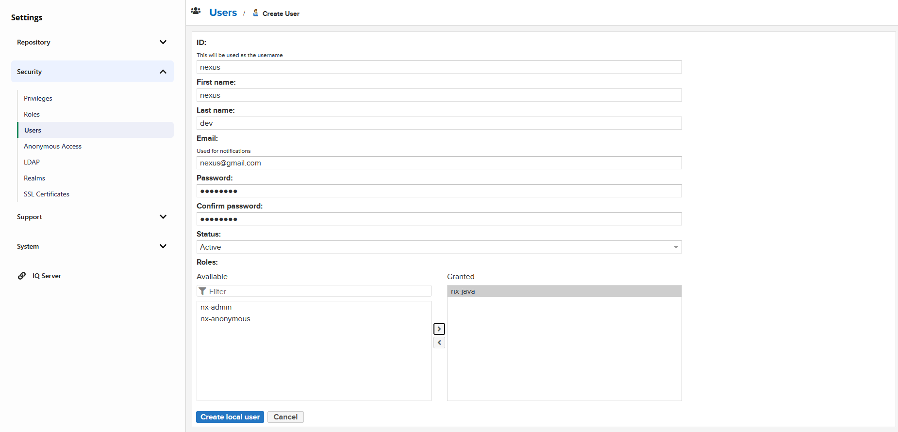

   Move `nx-java` from **Available** to **Granted**, then select **Create local user**. Do not reuse the administrator password.

3. **Verify the user's access**

   In the Ubuntu server terminal, run the following command after replacing `<ubuntu-server-ip>` with the real IP address:

   ```bash
   curl -i -u nexus http://<ubuntu-server-ip>:8006/service/rest/v1/status
   ```

   When curl displays `Enter host password for user 'nexus':`, enter the password created in the previous step. The password is not displayed. Do not place the password after `nexus:` in the command because that would save it in shell history and may expose it in the screenshot.

   A successful request returns an HTTP status line containing:

   ```text
   HTTP/1.1 200 OK
   ```

   - Screenshot as `nexus_user_access.png`, showing the curl command, the `HTTP/1.1 200` response, and your required terminal prompt. The password must not be visible.

   If the response is `401 Unauthorized`, verify the user ID, password, and Active status. If repository access later returns `403 Forbidden`, verify that `nx-java` is granted to the user and contains the required Maven snapshots privilege.

**Screenshot Required:**

- `nexus_user_access.png`

**Summary:** The local `nexus` user is active, receives Maven snapshots access through the `nx-java` role, and can authenticate to Nexus.

---

## Task 3: Build and Publish the Gradle Application to Nexus

Run the Nexus container on the Ubuntu server as configured in Tasks 1 and 2. Perform the project editing, Gradle build and Gradle publication commands in the **IntelliJ IDEA terminal** used in Lab 5.

1. **Clone or reopen the Gradle project**

   From the IntelliJ Welcome screen, select **Clone Repository** or **Get from Version Control** and use:

   - **URL:** `https://gitlab.com/nanuchi/java-app.git`
   - **Directory:** `/config/IdeaProjects/java-app`

   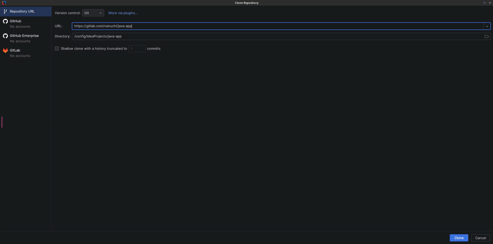

   If `/config/IdeaProjects/java-app` already exists from Lab 5, do not create a duplicate clone. Select **Open** or **Recent Projects** and open that existing directory.

2. **Configure the project JDK**

   In IntelliJ IDEA, select **File → Project Structure**.

   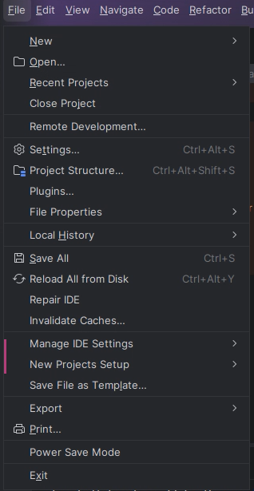

   Under **Project Settings → Project**, configure:

   | Setting | Required value |
   | --- | --- |
   | Project SDK | JDK 16 |
   | Project language level | `8 - Lambdas, type annotations, etc.` |

   If JDK 16 is not listed, open the SDK menu and select **Download JDK**. You may use Azul Zulu or another JDK vendor, but select the architecture that matches your computer. The instructor image uses ARM64 because it was captured on an ARM server; students using `x86_64` must select the matching `x86_64` JDK.

   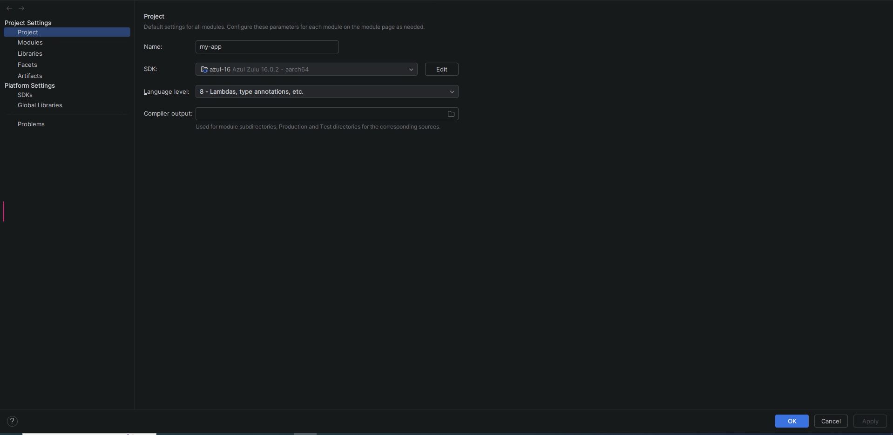

   Select **Apply**, then **OK**.

3. **Configure `build.gradle` for Maven publication**

   Open `build.gradle`. Ensure its `plugins` block contains each plugin exactly once:

   ```groovy
   plugins {
       id 'java'
       id 'maven-publish'
       id 'org.springframework.boot' version '2.2.2.RELEASE'
       id 'io.spring.dependency-management' version '1.0.8.RELEASE'
   }
   ```

   Do not add a second `java` or `maven-publish` entry if it already exists.

   Keep the project's existing Maven coordinates. Verify that the file contains:

   ```groovy
   group = 'com.example'
   version = '1.0-SNAPSHOT'
   ```

   Add the following `publishing` block immediately after the existing `group` and `version` lines. Replace `<ubuntu-server-ip>` with the IP address of the Ubuntu server running Nexus; do not include angle brackets in the final URL.

   ```groovy
   publishing {
       publications {
           maven(MavenPublication) {
               artifact("build/libs/my-app-$version" + ".jar") {
                   extension "jar"
               }
           }
       }
       repositories {
           maven {
               name "nexus"
               url "http://<ubuntu-server-ip>:8006/repository/maven-snapshots/"
               allowInsecureProtocol = true
               credentials {
                   username project.repoUser
                   password project.repoPassword
               }
           }
       }
   }
   ```

   `allowInsecureProtocol = true` is required here because this classroom Nexus URL uses HTTP. Do not use this setting as a substitute for HTTPS in a production deployment.

4. **Set the project name**

   Open `settings.gradle` and set its contents to:

   ```groovy
   rootProject.name = 'my-app'
   ```

   This name makes the generated JAR begin with `my-app`.

5. **Create `gradle.properties`**

   In IntelliJ's **Project** pane, right-click the `java-app` project root and select **New → File**.

   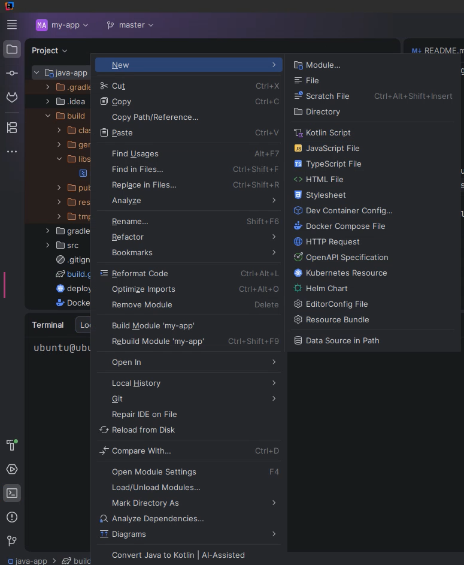

   Enter this filename and press **Enter**:

   ```text
   gradle.properties
   ```

   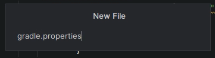

   Add these two lines, using the `nexus` user's password created in Task 2:

   ```properties
   repoUser=nexus
   repoPassword=<nexus-user-password>
   ```

   Save the project-level `gradle.properties` file. Never display its contents in a screenshot, commit it to Git, include it in `Lab6_Solution.pdf`, or expose its password in terminal output.

   - Screenshot as `gradle_nexus_configuration.png`, showing the updated `build.gradle` publication/repository configuration and `settings.gradle`. Keep the required terminal identity visible, but do not show `gradle.properties` or either password.

6. **Build the JAR**

   Open IntelliJ's terminal in the `java-app` project and run:

   ```bash
   ./gradlew clean build
   ```

   Wait for `BUILD SUCCESSFUL`. In IntelliJ's Project pane, expand `build/libs/` and confirm that it contains:

   ```text
   my-app-1.0-SNAPSHOT.jar
   ```

   - Screenshot as `gradle_nexus_build.png`, showing `./gradlew clean build`, `BUILD SUCCESSFUL`, and the generated `my-app-1.0-SNAPSHOT.jar`.

7. **Publish the JAR to Nexus**

   Run:

   ```bash
   ./gradlew clean build publish
   ```

   Gradle should run the Nexus publication task and finish with `BUILD SUCCESSFUL`.

   - Screenshot as `gradle_nexus_publish.png`, showing the command, the Nexus publish task and `BUILD SUCCESSFUL`. Do not display the credentials file or password.

   If publication returns `401 Unauthorized`, verify `repoUser`, `repoPassword` and the Active status of the `nexus` user. If it returns `403 Forbidden`, confirm that the user has the `nx-java` role and that the role contains `nx-repository-view-maven2-maven-snapshots-*`.

8. **Verify the artifact in Nexus**

   Open the Nexus web application:

   ```text
   http://<ubuntu-server-ip>:8006
   ```

   Sign in and open the navigation menu if it is collapsed.

   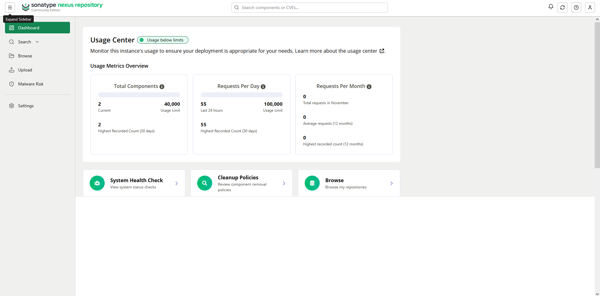

   Select **Browse**, then select the hosted `maven-snapshots` repository.

   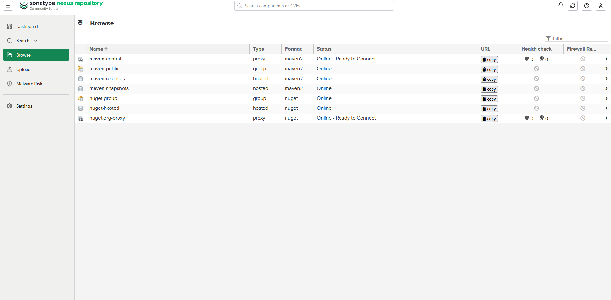

   Expand this path:

   ```text
   com → example → my-app → 1.0-SNAPSHOT
   ```

   Expand the `1.0-SNAPSHOT` folder and confirm that Nexus contains the published JAR, POM and Maven metadata/checksum files. Nexus may store the snapshot JAR with a timestamp and build number rather than the literal `SNAPSHOT` filename.

   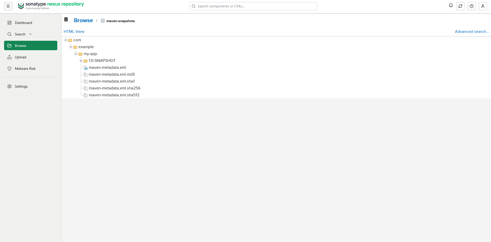

   The instructor reference image shows the repository hierarchy and metadata. For your required evidence, expand `1.0-SNAPSHOT` one level further so the JAR filename is also visible.

   - Screenshot as `nexus_gradle_artifact.png`, showing `maven-snapshots`, the expanded `com/example/my-app/1.0-SNAPSHOT` path, the published JAR and the metadata. Keep the required terminal prompt visible beside the browser.

**Screenshot Required:**

- `gradle_nexus_configuration.png`
- `gradle_nexus_build.png`
- `gradle_nexus_publish.png`
- `nexus_gradle_artifact.png`

**Summary:** IntelliJ used JDK 16 to build the renamed `my-app` Gradle project. Gradle read the deployment credentials from the uncommitted project-level `gradle.properties` file and published the snapshot JAR and Maven metadata to Nexus.

---

## Task 4: Publish the Maven Application to Nexus

Keep the Nexus container running on the Ubuntu server. Perform the Maven project editing, packaging and deployment commands in the **IntelliJ IDEA terminal** used in Lab 5.

1. **Clone or reopen the Maven project**

   From IntelliJ's Welcome screen, select **Clone Repository** or **Get from Version Control** and use:

   - **URL:** `https://gitlab.com/nanuchi/java-maven-app.git`
   - **Directory:** `/config/IdeaProjects/java-maven-app`

   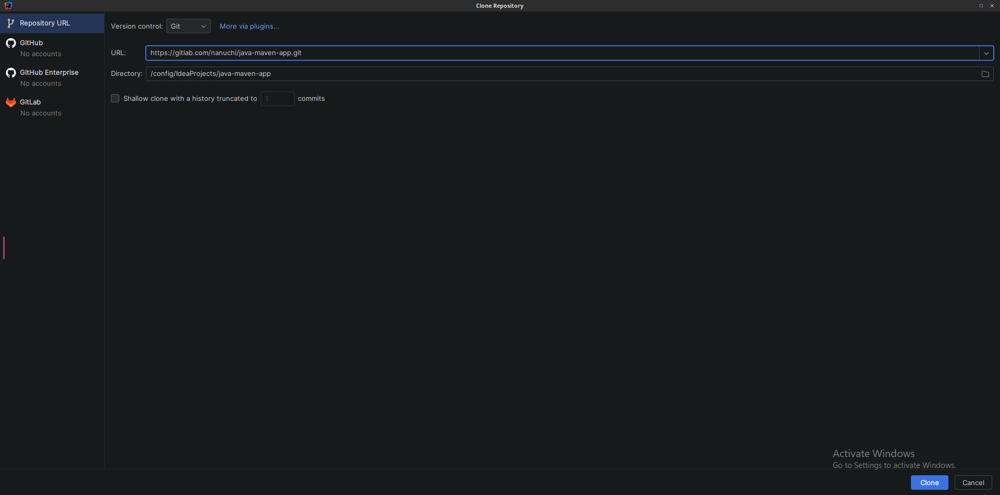

   If `/config/IdeaProjects/java-maven-app` already exists from Lab 5, do not clone it again. Select **Open** or **Recent Projects** and open the existing directory.

   - Screenshot as `maven_nexus_project.png`, showing the successfully opened `java-maven-app` project in IntelliJ.

2. **Add snapshot distribution management to `pom.xml`**

   Open `pom.xml`. Add this block as a direct child of the top-level `<project>` element, immediately after the project's existing `<version>` line. Do not place it inside `<dependencies>` or `<build>`.

   Replace `<ubuntu-server-ip>` with the IP address of the Ubuntu server running Nexus. Keep the URL on one line.

   ```xml
   <distributionManagement>
       <snapshotRepository>
           <id>nexus-snapshots</id>
           <url>http://<ubuntu-server-ip>:8006/repository/maven-snapshots/</url>
       </snapshotRepository>
   </distributionManagement>
   ```

   The project version ends with `SNAPSHOT`, so Maven uses this `snapshotRepository` when it deploys the artifact.

   - Screenshot as `maven_distribution_management.png`, showing the complete saved `distributionManagement` block and the surrounding top-level `pom.xml` structure. Keep the required terminal identity visible.

3. **Configure the Nexus deployment credentials**

   Open IntelliJ's terminal and install Vim:

   ```bash
   sudo apt install -y vim
   ```

   Open the Maven settings file:

   ```bash
   vim ~/.m2/settings.xml
   ```

   Press **i** to enter Insert mode and add:

   ```xml
   <settings>
       <servers>
           <server>
               <id>nexus-snapshots</id>
               <username>nexus</username>
               <password>REPLACE_WITH_NEXUS_PASSWORD</password>
           </server>
       </servers>
   </settings>
   ```

   Replace `REPLACE_WITH_NEXUS_PASSWORD` with the password created for the `nexus` user in Task 2. The server ID must remain exactly `nexus-snapshots` because it must match the ID in `pom.xml`.

   Press **Esc**, type `:wq`, and press **Enter** to save and close Vim.

   Never display `settings.xml` in a screenshot, commit it to Git, include it in `Lab6_Solution.pdf`, or expose the password in terminal output.

4. **Package the Maven application**

   In IntelliJ's terminal, run:

   ```bash
   mvn package
   ```

   Wait for `BUILD SUCCESS` and verify that Maven creates the snapshot JAR under `target/`.

   - Screenshot as `maven_package_nexus.png`, showing `mvn package`, `BUILD SUCCESS`, and the generated snapshot JAR filename.

5. **Deploy the snapshot to Nexus**

   Run:

   ```bash
   mvn deploy
   ```

   Maven runs the lifecycle through the deploy phase and uploads the JAR, POM, checksums and metadata to the configured Nexus snapshot repository.

   - Screenshot as `maven_deploy_nexus.png`, showing `mvn deploy`, the Nexus upload lines and `BUILD SUCCESS`. Do not show the password or `settings.xml`.

   If deployment returns `401 Unauthorized`, verify the username, password and matching `nexus-snapshots` IDs. If it returns `403 Forbidden`, confirm that the `nexus` user is Active and has the `nx-java` role containing `nx-repository-view-maven2-maven-snapshots-*`.

6. **Verify the Maven artifact in Nexus**

   Open and sign in to:

   ```text
   http://<ubuntu-server-ip>:8006
   ```

   Select **Browse → maven-snapshots**, then expand:

   ```text
   com → example → java-maven-app → 1.1.0-SNAPSHOT
   ```

   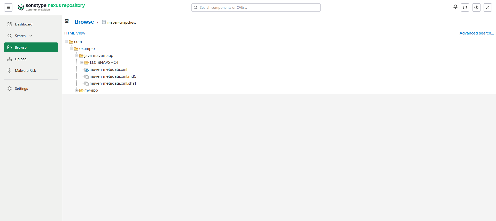

   The instructor reference image shows the Maven repository hierarchy and metadata. For your required evidence, expand `1.1.0-SNAPSHOT` so the published JAR, POM and metadata/checksum files are visible. Nexus may use timestamped filenames for the snapshot.

   - Screenshot as `nexus_maven_artifact.png`, showing the expanded `com/example/java-maven-app/1.1.0-SNAPSHOT` path, the JAR, POM and Maven metadata. Keep the required terminal prompt visible beside the browser.

**Screenshot Required:**

- `maven_nexus_project.png`
- `maven_distribution_management.png`
- `maven_package_nexus.png`
- `maven_deploy_nexus.png`
- `nexus_maven_artifact.png`

**Summary:** Maven read the deployment destination from `pom.xml`, matched it to the private credentials in `~/.m2/settings.xml`, packaged the snapshot JAR and deployed the artifact and metadata to Nexus.

---

## Task 5: Inspect Nexus Repositories and Components Using the REST API

Run every command in this task directly from the **Ubuntu server terminal**. Keep the Nexus container running. These requests use the Nexus Repository REST API and compare the access available to the restricted `nexus` user with the `admin` user.

> **Password safety:** Do not place a real password directly in the command. Using `curl -u nexus` or `curl -u admin` makes curl prompt for the password securely; the entered password is not displayed or stored as part of the command.

1. **List repositories as the `nexus` user**

   Run:

   ```bash
   curl -u nexus -X GET "http://<ubuntu-server-ip>:8006/service/rest/v1/repositories"
   ```

   Enter the `nexus` user's password when curl prompts for it. Review the returned JSON and note which repositories are visible to this restricted user.

   - Screenshot as `nexus_repositories_user.png`, showing the command, the repository response and your required terminal prompt. The password must not be visible.

2. **List repositories as the `admin` user**

   Run the same request with the administrator account:

   ```bash
   curl -u admin -X GET "http://<ubuntu-server-ip>:8006/service/rest/v1/repositories"
   ```

   Enter the current `admin` password when prompted. Compare this response with the response returned for the `nexus` user.

   - Screenshot as `nexus_repositories_admin.png`, showing the command, the repository response and your required terminal prompt. The password must not be visible.

3. **List the components in `maven-snapshots`**

   Authenticate as the `nexus` user and request the components stored in the Maven snapshots repository:

   ```bash
   curl -u nexus -X GET "http://<ubuntu-server-ip>:8006/service/rest/v1/components?repository=maven-snapshots"
   ```

   Enter the `nexus` user's password when prompted. In the JSON response, locate the `items` array and identify one component's `id`. The response can also contain a `continuationToken` when more results are available.

   - Screenshot as `nexus_components_list.png`, showing the command and a returned component with its `id`, `repository`, `name` and `version`. The password must not be visible.

4. **Get one component's details by ID**

   Copy one exact component `id` from Step 3 and replace `<component-id>` below:

   ```bash
   curl -u nexus -X GET "http://<ubuntu-server-ip>:8006/service/rest/v1/components/<component-id>"
   ```

   Enter the `nexus` user's password when prompted. Verify that the response describes the selected component and includes its repository, format, group, name, version and assets.

   - Screenshot as `nexus_component_details.png`, showing the command with the selected component ID and the returned component details. The password must not be visible.

**Screenshot Required:**

- `nexus_repositories_user.png`
- `nexus_repositories_admin.png`
- `nexus_components_list.png`
- `nexus_component_details.png`

**Summary:** You queried the Nexus repositories with both the restricted `nexus` account and the `admin` account, listed the components in `maven-snapshots`, and retrieved one component by its REST API ID without exposing either password.

---

## Task 6: Create a Nexus Blob Store and Docker Hosted Repository

Run the Docker commands in this task directly from the **Ubuntu server terminal**. Use the Nexus web application as the `admin` user for the blob-store and repository configuration.

1. **Open the Blob Stores page**

   Sign in to Nexus as `admin`, then open:

   **Settings → Repository → Blob Stores**

   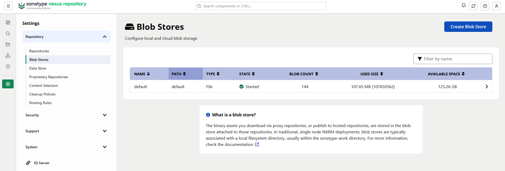

   Confirm that the existing `default` file blob store is in the **Started** state.

2. **Inspect the default blob-store directory inside the Nexus container**

   From the Ubuntu server terminal, open a shell in the Nexus container:

   ```bash
   docker exec -it nexus /bin/sh
   ```

   The container shell opens under `/opt/sonatype`. Run:

   ```sh
   pwd
   cd sonatype-work/nexus3
   cd blobs
   ls
   ls default/content
   ```

   The first `ls` should show the `default` blob-store directory. The second command displays its content structure.

   This is a **read-only inspection**. Do not edit, rename or delete any file inside the blob-store directory.

   Keep this container shell open because it will be reused in Step 4.

   - Screenshot as `nexus_default_blob_content.png`, showing the Ubuntu prompt that launched `docker exec`, the `blobs` path, the `default` directory and the output of `ls default/content`.

3. **Create the `mystore` file blob store**

   On the **Blob Stores** page, select **Create Blob Store** and configure:

   - **Type:** `File`
   - **Name:** `mystore`
   - **Path:** `/nexus-data/blobs/mystore`
   - **Soft Quota:** Disabled

   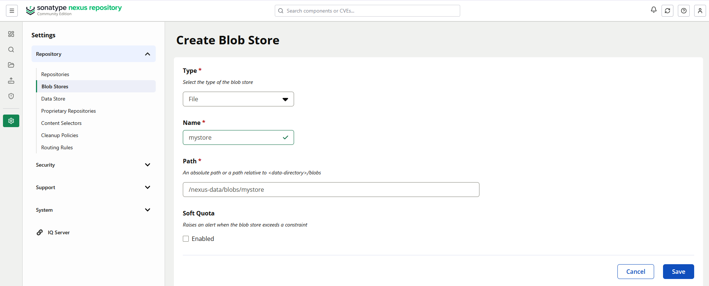

   Select **Save**. The Blob Stores page must now show both `default` and `mystore` in the **Started** state.

   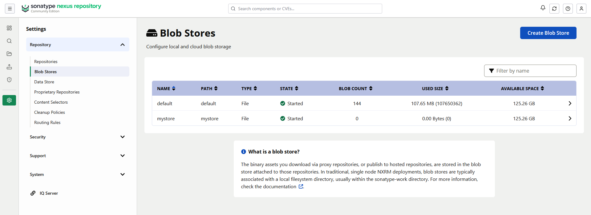

   - Screenshot as `nexus_mystore_created.png`, showing both `default` and `mystore`, their `File` type and their **Started** state. Keep the required Ubuntu terminal identity visible beside the browser.

4. **Verify the new blob-store directory inside the existing container shell**

   Return to the Nexus container shell that you kept open in Step 2. Do not run `docker exec` again. Run:

   ```sh
   pwd
   ls
   ls mystore
   exit
   ```

   The `pwd` output must show the `blobs` directory, and the `ls` output must show both `default` and `mystore`. The final `exit` returns you to the Ubuntu server terminal.

   - Screenshot as `nexus_blob_directories.png`, showing the existing container shell, the `blobs` path, the `default` and `mystore` directories, and the Ubuntu prompt after `exit`.

5. **Create a Docker hosted repository that uses `mystore`**

   In Nexus, open:

   **Settings → Repository → Repositories**

   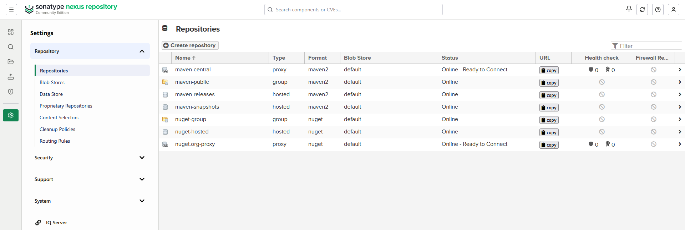

   Select **Create repository**, choose **docker (hosted)** and configure:

   - **Name:** `docker-hosted`
   - **Online:** Enabled
   - **Repository connector:** **Other Connectors**
   - **HTTP connector:** `8007`
   - **HTTPS connector:** Leave empty
   - **Allow anonymous Docker pulls:** Disabled
   - **Docker V1 API:** Disabled
   - **Blob store:** `mystore`
   - **Strict Content Type Validation:** Enabled
   - **Deployment policy:** `Allow redeploy`

   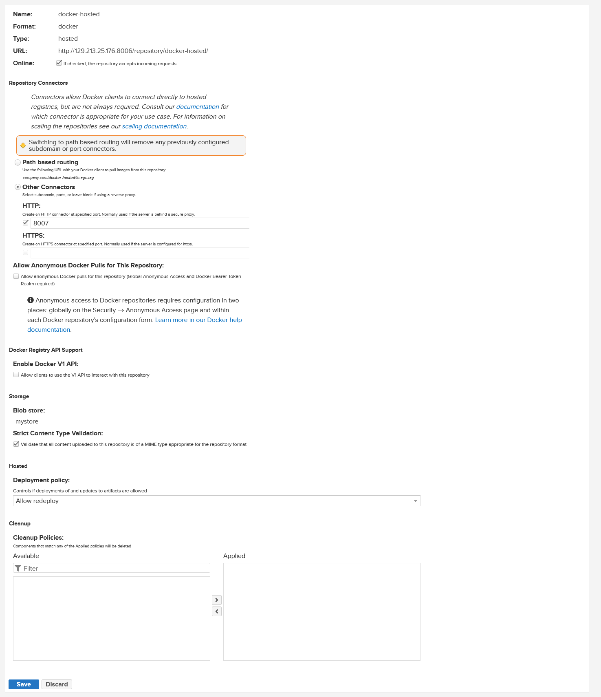

   > Use connector port `8007` because Task 1 publishes `8007:8007` for the Nexus container.

   Select **Create repository**. Return to the repository list and verify that `docker-hosted` is **Online**, its format is `docker`, its type is `hosted`, and its blob store is `mystore`.

   - Screenshot as `nexus_docker_hosted_repository.png`, showing the saved `docker-hosted` repository and its `mystore` blob-store assignment. Also show the configured HTTP connector `8007`, either by reopening the saved repository or in the same readable evidence view. Keep the required Ubuntu terminal identity visible beside the browser.

**Screenshot Required:**

- `nexus_default_blob_content.png`
- `nexus_mystore_created.png`
- `nexus_blob_directories.png`
- `nexus_docker_hosted_repository.png`

**Summary:** You inspected Nexus blob storage without modifying its files, created the `mystore` file blob store, verified its directory inside the container, and created an online Docker hosted repository that uses `mystore` through connector port `8007`.

---

## Task 7: Create and Run a Maven Snapshot Cleanup Policy

This task removes every component currently visible in the `maven-snapshots` repository. Complete Tasks 3–5 first and capture all required publishing and REST API evidence before running this cleanup.

> **Destructive action:** The Asset Name Matcher `.*` matches all snapshot assets. After the cleanup service runs, the published Gradle and Maven components will no longer appear in `maven-snapshots`. Do not run the task until your earlier screenshots and `Lab6_Solution.pdf` evidence are saved.

1. **Create the Maven cleanup policy**

   **Settings → Repository → Cleanup Policies → Create Cleanup Policy**

   Configure:

   - **Name:** `maven`
   - **Format:** `maven2`
   - **Release Type:** `Pre-Releases/Snapshots`
   - **Component Age:** Not selected
   - **Component Usage:** Not selected
   - **Asset Name Matcher:** Selected
   - **Regular expression:** `.*`

   Under **Preview Repository**, select `maven-snapshots` and select **Preview**. Confirm that the preview lists the Gradle and Maven snapshot components created earlier.

   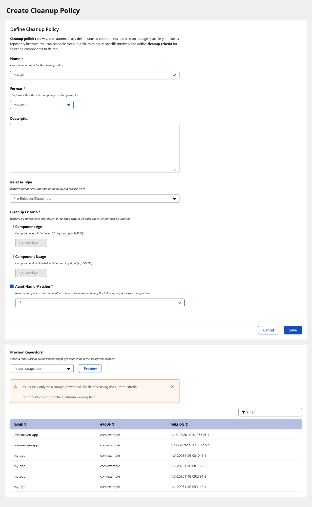

   Carefully review the preview, then select **Save**.

   - Screenshot as `nexus_cleanup_policy_created.png`, showing the `maven` policy, `maven2` format, snapshot release type, `.*` matcher and the populated `maven-snapshots` preview. Keep the required Ubuntu terminal identity visible beside the browser.

2. **Attach the policy to `maven-snapshots`**

   Open:

   **Settings → Repository → Repositories → maven-snapshots**

   In **Cleanup Policies**, move `maven` from **Available** to **Applied**, then select **Save**.

   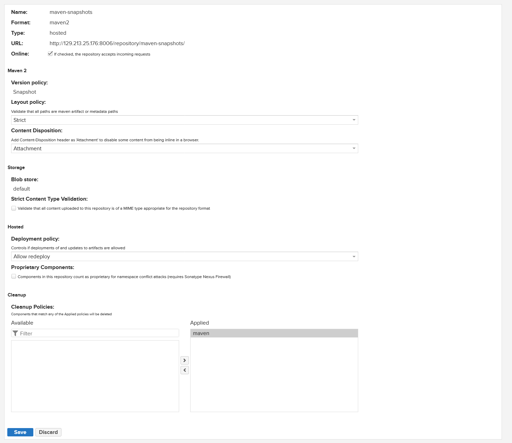

   Reopen `maven-snapshots` and verify that `maven` remains in the **Applied** list.

   - Screenshot as `nexus_cleanup_policy_attached.png`, showing the `maven-snapshots` repository name and the saved `maven` policy in **Applied**. Keep the required Ubuntu terminal identity visible beside the browser.

3. **Verify the cleanup service schedule**

   Open:

   **Settings → System → Tasks**

   Locate **Cleanup service**, whose type is **Admin - Cleanup repositories using their associated policies**.

   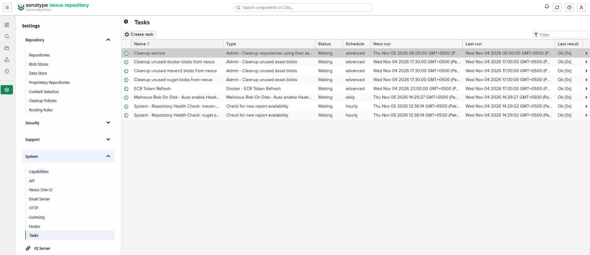

   Open **Cleanup service** and verify:

   - **Status:** `Waiting`
   - **Next run:** The following day at `06:00:00`
   - **Last result:** `Ok`, when a previous run exists

   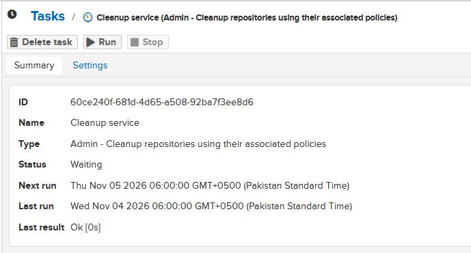

   If your instance does not show the next run at 6:00 AM, open the task's **Settings** tab, configure its daily schedule for **06:00**, save it and return to **Summary**.

   - Screenshot as `nexus_cleanup_task_waiting.png`, showing **Cleanup service**, `Waiting` status and the next run scheduled for 6:00 AM. Keep the required Ubuntu terminal identity visible beside the browser.

4. **Run the cleanup service manually**

   Confirm once more that all earlier Lab 6 evidence has been saved. On the **Cleanup service** task page, select **Run** (the play button) and confirm the action.

   Wait for execution to finish, refresh the page and verify that the task returns to **Waiting** with **Last result: Ok** and an updated **Last run** time.

   - Screenshot as `nexus_cleanup_task_completed.png`, showing the cleanup service after the manual execution, including the updated **Last run** and **Last result: Ok**. Keep the required Ubuntu terminal identity visible beside the browser.

5. **Verify that `maven-snapshots` is empty**

   Open:

   **Browse → maven-snapshots**

   The repository must display **No component/assets found in repository**.

   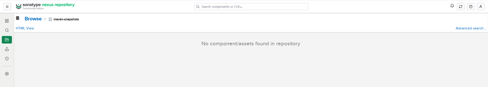

   - Screenshot as `nexus_maven_snapshots_empty.png`, showing the `maven-snapshots` repository and the **No component/assets found in repository** message. Keep the required Ubuntu terminal identity visible beside the browser.

6. **Check the blob store before compaction**

   Open:

   **Settings → Repository → Blob Stores**

   The `maven-snapshots` repository is empty, but the `default` blob store can still show a high blob count and used size because the cleanup service performs soft deletion.

   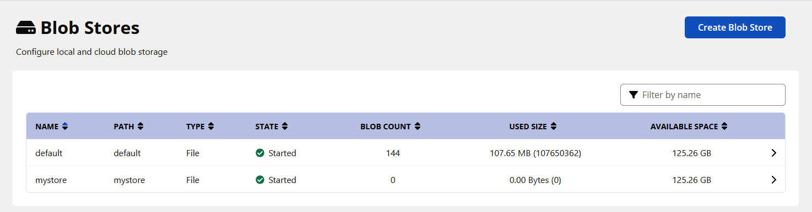

   Record the `default` blob store's **Blob Count**, **Used Size** and **Available Space**. The exact values will differ between students.

   - Screenshot as `nexus_blob_store_before_compaction.png`, showing the `default` blob store and its blob count, used size and available space before compaction. Keep the required Ubuntu terminal identity visible beside the browser.

7. **Create the compact blob-store task**

   Open:

   **Settings → System → Tasks → Create task**

   In the task-type filter, enter `compact`, then select **Admin - Compact blob store**.

   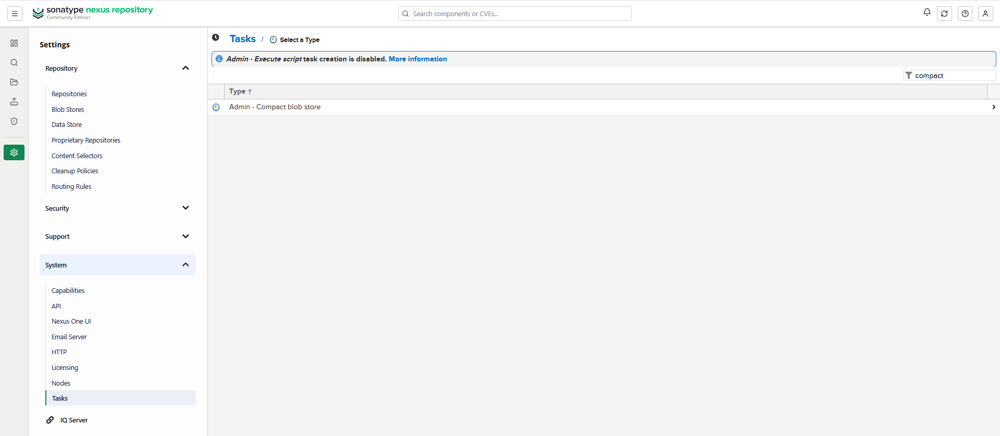

   Configure the task:

   - **Task enabled:** Selected
   - **Task name:** `compact-store`
   - **Notification email:** Leave empty
   - **Send notification on:** `Failure`
   - **Blob store:** `default`
   - **Blobs Older Than:** `0`
   - **Task frequency:** `Daily`
   - **Start date:** The current date
   - **Time to run this task:** `06:30`

   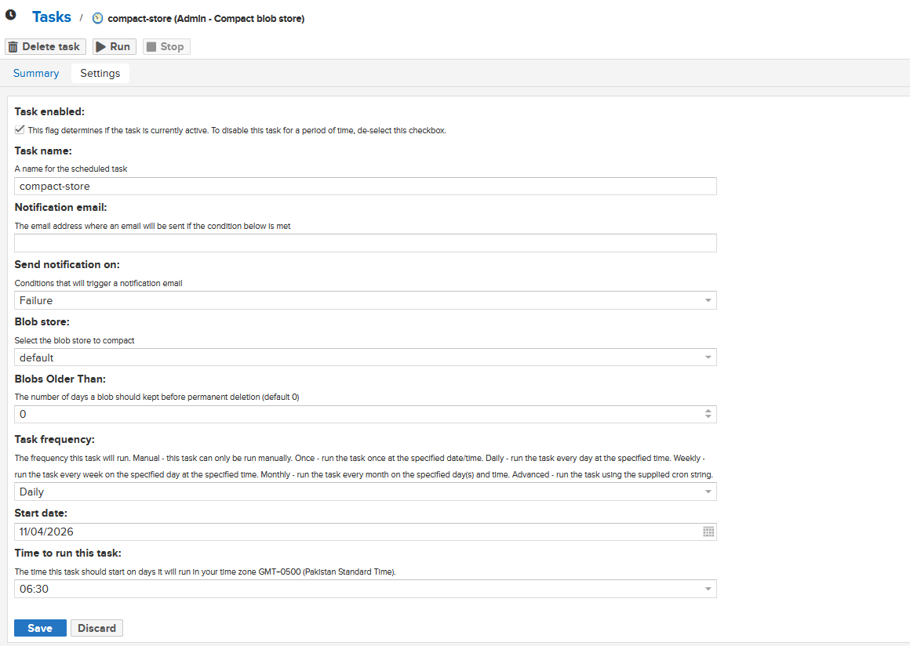

   Select **Save**. Reopen `compact-store` and verify that it is enabled, targets `default` and has the configured schedule.

   - Screenshot as `nexus_compact_task_configured.png`, showing the saved `compact-store` settings, `default` blob store, `0` days and the 06:30 daily schedule. Keep the required Ubuntu terminal identity visible beside the browser.

8. **Run the compact task manually**

   Open the `compact-store` task. Its Summary page should show **Type: Admin - Compact blob store** and **Status: Waiting**.

   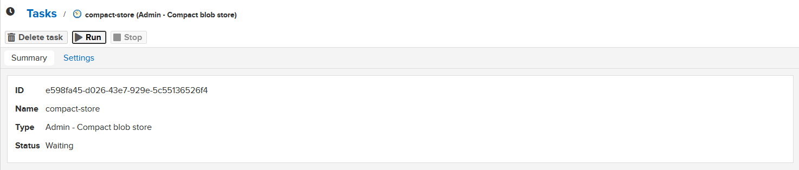

   > **Permanent deletion:** Running this task permanently removes blobs that were soft-deleted by the cleanup process and meet the `0`-day setting. Confirm that every required earlier screenshot and solution-file item has already been saved.

   Select **Run**, confirm the action and wait for the task to finish. Refresh until the task returns to **Waiting** and shows **Last result: Ok**.

   - Screenshot as `nexus_compact_task_completed.png`, showing `compact-store` after manual execution with an updated **Last run** and **Last result: Ok**. Keep the required Ubuntu terminal identity visible beside the browser.

9. **Verify that blob-store space was reclaimed**

   Return to:

   **Settings → Repository → Blob Stores**

   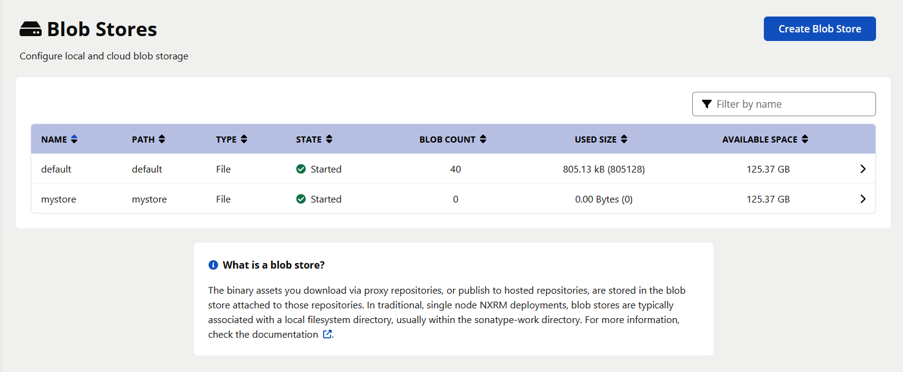

   Compare the `default` row with Step 6. Its blob count and used size should be lower, while its available space should be higher. The exact values are not graded because they depend on the student's previous Nexus activity. The blob store does not need to reach zero because Nexus can retain other required files.

   - Screenshot as `nexus_blob_store_after_compaction.png`, showing the `default` blob store after compaction with its updated blob count, used size and available space. Keep the required Ubuntu terminal identity visible beside the browser.

The cleanup service first removes matching components from repository browsing through soft deletion. The compact task then permanently deletes eligible soft-deleted blobs and reclaims their disk space.

**Screenshot Required:**

- `nexus_cleanup_policy_created.png`
- `nexus_cleanup_policy_attached.png`
- `nexus_cleanup_task_waiting.png`
- `nexus_cleanup_task_completed.png`
- `nexus_maven_snapshots_empty.png`
- `nexus_blob_store_before_compaction.png`
- `nexus_compact_task_configured.png`
- `nexus_compact_task_completed.png`
- `nexus_blob_store_after_compaction.png`

**Summary:** You created a cleanup policy that matches every Maven snapshot component, attached it to `maven-snapshots`, ran the cleanup service manually, created and ran the `compact-store` task, and verified that the default blob store reclaimed disk space.

---

## Summary

- You reused the IntelliJ IDEA environment and Gradle project from Lab 5.
- You ran Nexus and its verification commands directly on the Ubuntu server.
- You ran Nexus Repository in a Docker container with a persistent named volume.
- You replaced the generated administrator password and disabled anonymous access.
- You created the `nx-java` role with Maven snapshots privileges.
- You created the active local `nexus` user and assigned the role.
- You verified the user through the Nexus Status API without exposing its password.
- You configured Gradle's Maven Publish plugin and stored the deployment credentials in the project-level `gradle.properties` file instead of hardcoding them in `build.gradle`.
- You built `my-app-1.0-SNAPSHOT.jar` and published it to Nexus.
- You verified the Gradle snapshot JAR and Maven metadata in `maven-snapshots`.
- You configured Maven snapshot distribution and matching private server credentials.
- You packaged and deployed `java-maven-app` to Nexus and verified its JAR, POM and metadata.
- You compared authenticated repository listings, listed Maven snapshot components and retrieved one component by ID through the Nexus REST API.
- You inspected the default blob-store directory without modifying it and created the `mystore` file blob store.
- You created an online `docker-hosted` repository backed by `mystore` on connector port `8007`.
- You attached a destructive Maven snapshot cleanup policy, ran the cleanup service manually and verified that `maven-snapshots` became empty.
- You compacted the `default` blob store and verified reduced used space and increased available space.

## Final Submission Checklist

- [ ] I reused the IntelliJ IDEA environment and the existing `java-app` Gradle project from Lab 5.
- [ ] I ran Nexus and every Task 1, Task 2, Task 5 and Task 6 terminal command directly on the Ubuntu server, not inside the IntelliJ container.
- [ ] The `nexus` container is running with ports `8006` and `8007` published.
- [ ] Nexus data uses the persistent `nexus-data` volume.
- [ ] I changed the generated `admin` password and disabled anonymous access.
- [ ] The saved `nx-java` role contains `nx-repository-view-maven2-maven-snapshots-*`.
- [ ] The local `nexus` user is Active and has the `nx-java` role.
- [ ] The authenticated Status API request returned HTTP 200.
- [ ] `build.gradle` contains `java`, `maven-publish`, the Nexus repository URL and the publication block.
- [ ] `settings.gradle` sets `rootProject.name = 'my-app'`.
- [ ] My Nexus credentials are stored in the project-level `gradle.properties` file and are not committed or shown in screenshots.
- [ ] `./gradlew clean build` created `my-app-1.0-SNAPSHOT.jar`.
- [ ] `./gradlew clean build publish` completed successfully.
- [ ] The Gradle snapshot JAR and Maven metadata are visible under `com/example/my-app/1.0-SNAPSHOT` in Nexus.
- [ ] `pom.xml` contains the `nexus-snapshots` distribution-management entry.
- [ ] `~/.m2/settings.xml` contains the matching `nexus-snapshots` server ID and is not committed or shown in screenshots.
- [ ] `mvn package` and `mvn deploy` both completed successfully.
- [ ] The Maven snapshot JAR, POM and metadata are visible under `com/example/java-maven-app/1.1.0-SNAPSHOT` in Nexus.
- [ ] I queried the repository list as both the `nexus` user and the `admin` user.
- [ ] I listed the components in `maven-snapshots` and retrieved one component by its exact ID.
- [ ] No Nexus password appears in a curl command, screenshot, terminal history or solution file.
- [ ] I inspected the `default` blob-store directory without modifying its files.
- [ ] The `mystore` file blob store is in the Started state and its directory is visible inside the Nexus container.
- [ ] The `docker-hosted` repository is Online, uses the `mystore` blob store and has HTTP connector port `8007`.
- [ ] I captured all Gradle and Maven publishing evidence before starting Task 7.
- [ ] The `maven` cleanup policy uses the `maven2` format, snapshot release type and `.*` asset-name matcher.
- [ ] The `maven` policy is saved in the Applied list of `maven-snapshots`.
- [ ] The Cleanup service is scheduled for 6:00 AM and its manual run completed with `Last result: Ok`.
- [ ] `maven-snapshots` displays `No component/assets found in repository` after cleanup.
- [ ] I recorded the `default` blob-store values before compaction.
- [ ] The enabled `compact-store` task targets `default`, uses `0` days and is scheduled daily at 06:30.
- [ ] The manual compact task completed with `Last result: Ok`.
- [ ] The `default` blob store shows reduced used size and increased available space after compaction.
- [ ] All 28 currently required screenshots use the exact filenames in `Labs/Lab06/screenshots/`.
- [ ] My required Ubuntu terminal identity is readable in every screenshot.
- [ ] No password, generated `admin.password` value, private key, or token appears in any screenshot or solution file.
- [ ] `Lab6_Solution.pdf` contains my identity, captions, and the required evidence in task order.
- [ ] My complete `DevOps/Labs/Lab06` directory is visible on GitHub.

## Submission

Submit the URL of your own `DevOps/Labs/Lab06` directory after all Lab 6 tasks are published and completed.

Do not delete the `nexus` container or the `nexus-data` volume. The next task will continue using them.

## Official References

- [Sonatype: Install Self-Hosted Nexus Repository](https://help.sonatype.com/en/install-nexus-repository.html)
- [Sonatype: Nexus Repository Status API](https://help.sonatype.com/en/status-api.html)
- [Sonatype: Nexus Repository API Reference](https://help.sonatype.com/en/api-reference.html)
- [Sonatype: Repositories API](https://help.sonatype.com/en/repositories-api.html)
- [Sonatype: Blob Stores](https://help.sonatype.com/en/blob-stores.html)
- [Sonatype: Storage Guide](https://help.sonatype.com/en/storage-guide.html)
- [Sonatype: Docker Registry](https://help.sonatype.com/en/docker-registry.html)
- [Sonatype: Hosted Repository for Docker](https://help.sonatype.com/en/hosted-repository-for-docker.html)
- [Sonatype: Cleanup Policies](https://help.sonatype.com/en/cleanup-policies.html)
- [Sonatype: Tasks](https://help.sonatype.com/en/tasks.html)
- [Sonatype: Roles](https://help.sonatype.com/en/roles.html)
- [Sonatype: Users](https://help.sonatype.com/en/users.html)
- [Sonatype: Privileges](https://help.sonatype.com/en/privileges.html)
- [Sonatype: Anonymous Access](https://help.sonatype.com/en/anonymous-access.html)
- [Docker Hub: sonatype/nexus3](https://hub.docker.com/r/sonatype/nexus3)
- [Gradle: The Maven Publish Plugin](https://docs.gradle.org/current/userguide/publishing_maven.html)
- [Gradle: Supported Repository Protocols and Credentials](https://docs.gradle.org/current/userguide/supported_repository_protocols.html)
- [Gradle: Java Compatibility](https://docs.gradle.org/current/userguide/compatibility.html)
- [Gradle: Gradle Wrapper](https://docs.gradle.org/current/userguide/gradle_wrapper.html)
- [Maven: POM Distribution Management](https://maven.apache.org/pom.html#distribution-management)
- [Maven: Settings and Server Credentials](https://maven.apache.org/settings.html#servers)
- [Maven: Security and Deployment Settings](https://maven.apache.org/guides/mini/guide-deployment-security-settings.html)
- [Maven: Build Lifecycle and Deploy Phase](https://maven.apache.org/guides/introduction/introduction-to-the-lifecycle.html)
